
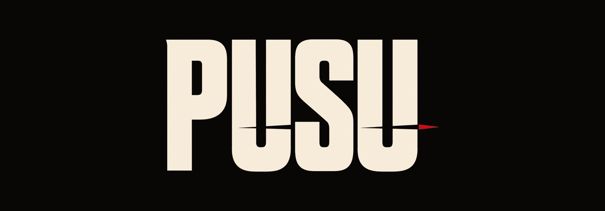

<h3 align="center">Tarayıcıda oynanan 5v5 taktik nişancı.</h3>

İndirme yok, kurulum yok, hesap şart değil. Linke tıkla, odayı kur, kodu arkadaşlarına at.

  <a href="https://esphi.github.io/pusu/"><b>▶&nbsp;&nbsp;HEMEN OYNA</b></a>
  &nbsp;·&nbsp; <a href="#modlar">Modlar</a>
  &nbsp;·&nbsp; <a href="#haritalar">Haritalar</a>
  &nbsp;·&nbsp; <a href="#kontroller">Kontroller</a>
  &nbsp;·&nbsp; <a href="#nasıl-çalışıyor">Nasıl çalışıyor</a>

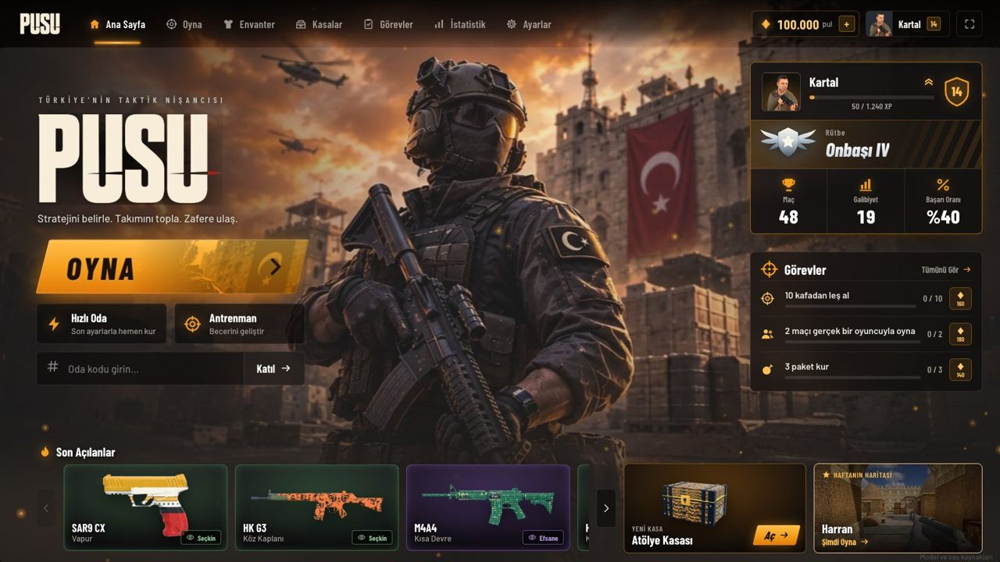

---

## Neden PUSU

- **Saniyeler içinde maç.** Oda kuran oyuncunun tarayıcısı sunucu olur, diğerleri dört harflik kodla bağlanır. Ayrı bir sunucuya, hesaba ya da indirmeye gerek yok.
- **Tanıdık his.** Paket kur / çöz, raund ekonomisi, silaha özgü geri tepme, koşarken dağılan isabet, malzemeye göre duvar delme, kafadan vuruş.
- **Gerçek isabet.** Vuruş, ekranda çizilen gövdenin kendisine göre hesaplanır; sunucu geri sarıp doğrular.
- **Yalnız da oynanır.** Kolaydan zora botlar paket kurar, çözer, siper alır, birbirini kollar. Arkadaşın gelmediyse boş yerleri botlar doldurur.
- **Yerli.** Kümbet evli Harran'dan Kapalıçarşı'ya, düğün salonundan hamama Türkiye'den çıkan haritalar; Türkçe arayüz, Türkçe telsiz, Türkçe ses.

<table>
<tr>
<td width="50%"></td>
<td width="50%">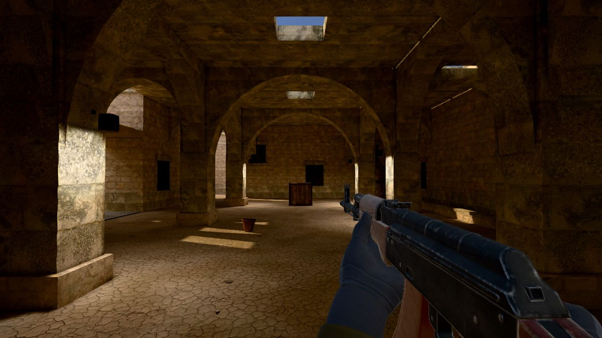</td>
</tr>
<tr>
<td align="center">Harran · Kümbet Avlusu (A)</td>
<td align="center">Harran · tavandan güneş giren sarnıç</td>
</tr>
</table>

## Modlar

| Mod | Ne yapıyorsun |
|---|---|
| **Paket** | Saldıranlar paketi A ya da B'ye kurar, savunanlar çözer. Raundlu, yarıda taraf değişir. |
| **Eleme** | Paket yok; ayakta kalan takım raundu alır. |
| **Bıçak** | Ateşli silah yok, yalnız bıçak. |
| **Silah Yarışı** | Her leşte yeni silah, son leş bıçakla. |
| **Serbest** | Ölen hemen doğar, bütün silahlar bedava. Isınmak için. |
| **Antrenman** | Bota karşı 1v1, nişan talimi, geri tepme talimi, bomba atış talimi. |

İsteğe bağlı **ajanlar**: 12 ajan, 36 yetenek (duvar, gözcü, ışınlanma, taret…). Oda ayarından açılır.

## Haritalar

<table>
<tr>
<td align="center">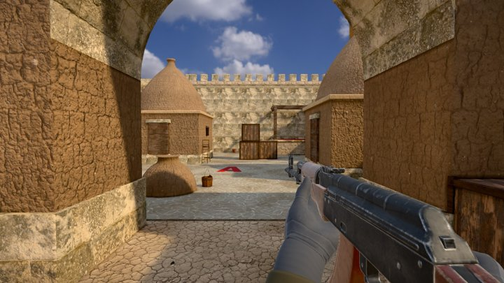 <b>Harran</b> Kümbet evleri, sur ve sarnıç · 5v5</td>
<td align="center">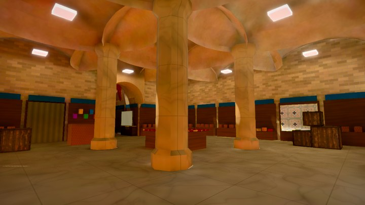 <b>Kapalıçarşı</b> Tonozlu çarşı, kırılan camlar · 5v5</td>
<td align="center">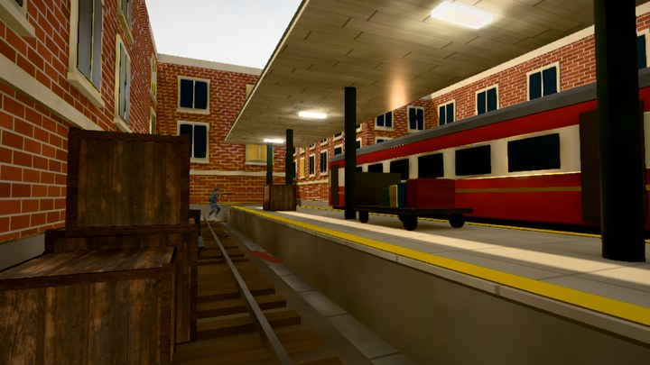 <b>İstasyon</b> Tren istasyonu · 5v5</td>
</tr>
<tr>
<td align="center">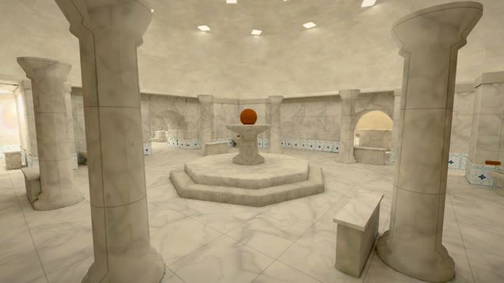 <b>Göbek-Taşı</b> Osmanlı hamamı · 5v5</td>
<td align="center">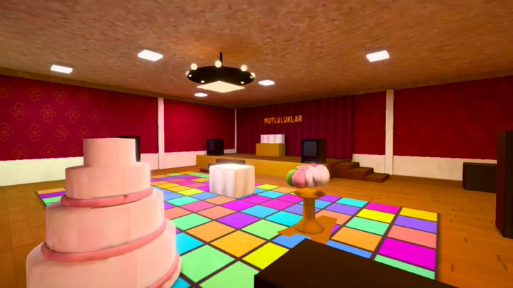 <b>Takı-Töreni</b> Düğün salonu · 5v5</td>
<td align="center">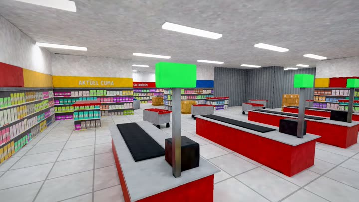 <b>Aktüel-Cuma</b> İndirim günü market · 5v5</td>
</tr>
<tr>
<td align="center">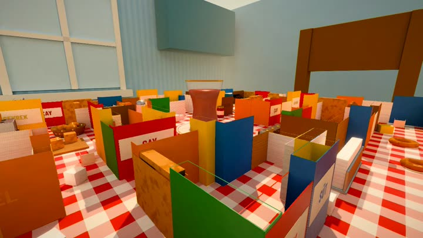 <b>Kahvaltı-99</b> Dev kahvaltı sofrası · 5v5</td>
<td align="center">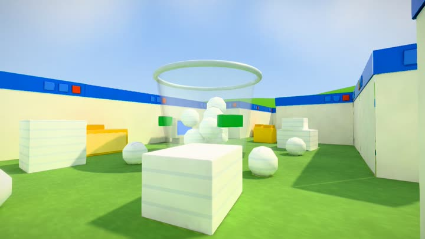 <b>Masaüstü-XP</b> Bilgisayar masaüstü · 5v5</td>
<td align="center">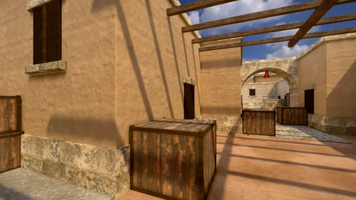 <b>Kasaba</b> Klasik üç yol · 2v2–3v3</td>
</tr>
<tr>
<td align="center">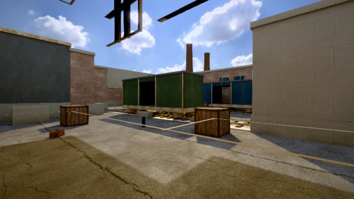 <b>Depo</b> Vagonların arasından · 2v2–3v3</td>
<td align="center">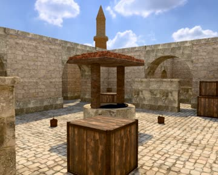 <b>Taşhan</b> Güneşli kervansaray · 1v1–2v2</td>
<td align="center">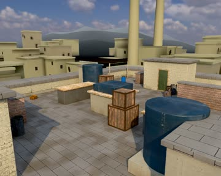 <b>Teras</b> Çatıda düello · 1v1–2v2</td>
</tr>
</table>

## Envanter, kasalar, ilerleme

<table>
<tr>
<td width="50%">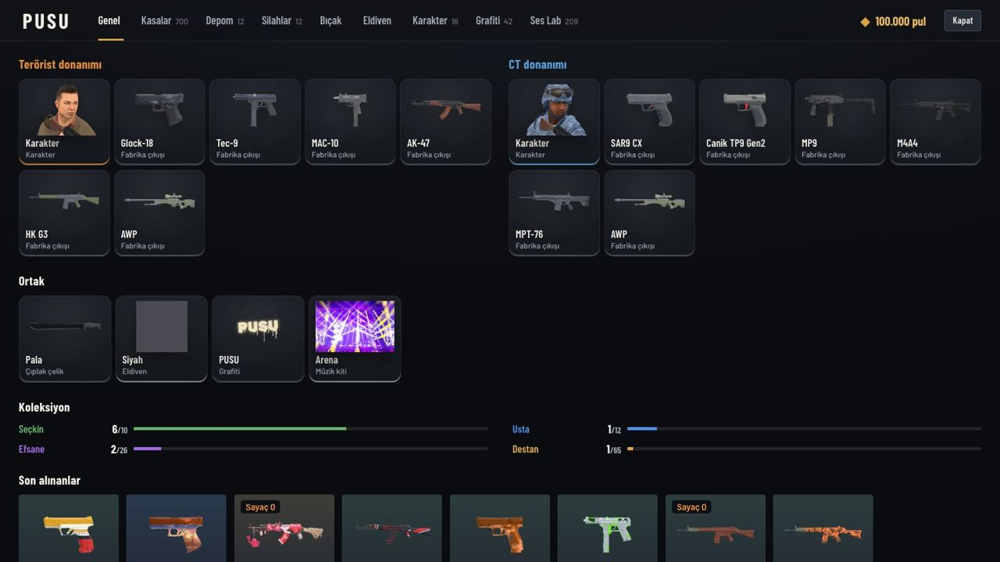</td>
<td width="50%">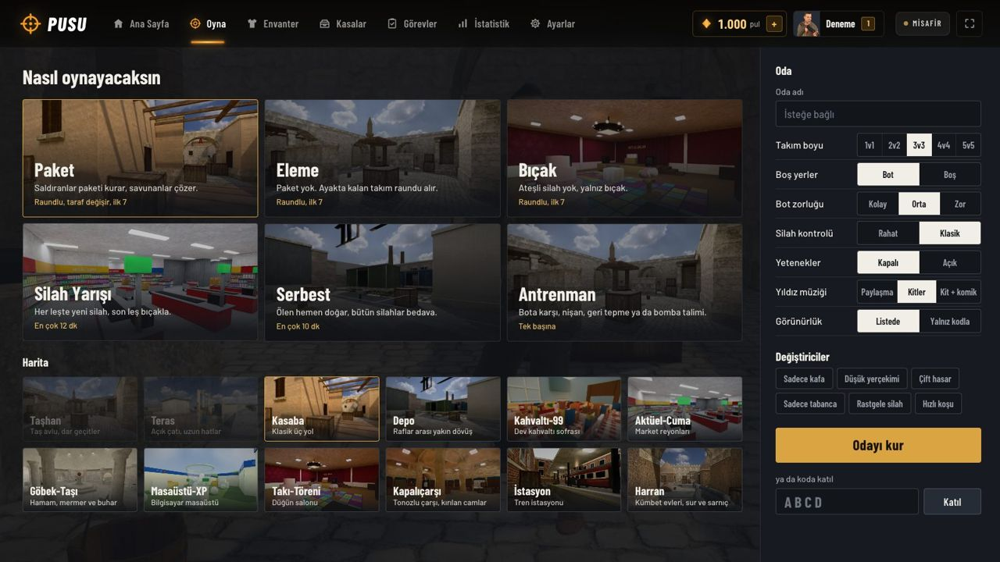</td>
</tr>
</table>

- **120+ skin**, 15 bıçak, 20 eldiven, karakterler, grafitiler, çıkartmalar ve müzik kitleri. Her skin kendi silahına özel.
- **Destan** skinler elde yaşar: kendi mermi izi, çekiş animasyonu ve raundun son leşinde oynayan **bitiriş** sahnesi; en nadirlerde bütün harita değişir.
- **14 kasa**, kasa düellosu, yükseltici, 5'li birleştirme, günlük ücretsiz kasa.
- **Seviye ve rütbe** (Çaylak'tan Paşa'ya), günlük ve haftalık görevler, 30+ başarım.
- **Gerçek para yok.** Pul yalnız oynayarak kazanılır.
- **Ses Lab**: müzik kitlerini dinle, olaylara (leş, kafadan, MVP…) kendi seslerini ata.

## Kontroller

| Tuş | İş | Tuş | İş |
|---|---|---|---|
| `W A S D` | Yürü | `B` | Satın alma menüsü |
| `Boşluk` | Zıpla | `E` | Al / paketi kur / çöz |
| `Ctrl` | Eğil | `1` `2` `3` `4` | Ana silah, tabanca, bıçak, bomba |
| `Shift` | Sessiz yürü | `Q` | Önceki silah |
| Sol tık | Ateş | `G` | Silahı bırak |
| Sağ tık | Dürbün / ağır bıçak | `F` | Silaha bak |
| `R` | Şarjör | `T` | Grafiti |
| `Tab` | Skor tablosu | `Enter` / `U` | Sohbet / takım sohbeti |
| `Z` | Telsiz sözleri | `V` | İşaret koy |
| `K` (basılı) | Takıma sesli konuş | `Esc` | Menü |

Bütün tuşlar **Ayarlar > Tuşlar**'dan değişir. Nişangâhı kendin tasarlayıp kodunu paylaşabilirsin.

## Nasıl çalışıyor

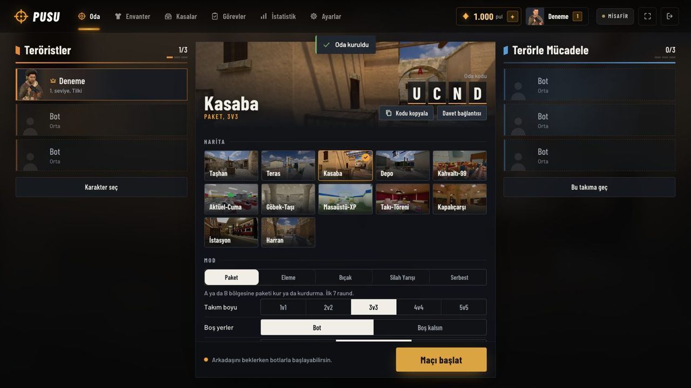

1. Biri **Oyna**'ya basıp oda kurar. Oyunun sunucusu onun tarayıcısında (Web Worker) çalışır.
2. Ekrandaki dört harfli kodu arkadaşlarına atar. Onlar **Oda kodu**'na yazıp bağlanır (WebRTC, PeerJS üzerinden eşleşme).
3. Odayı kuran oyundan düşerse oda bir başkasına devredilir, maç sürer. Kopan oyuncunun yerine geçici olarak bot girer; geri gelince parası, leşleri ve takımı yerinde.

İlerlemen (envanter, seviye, istatistik) tarayıcında saklanır. Hesapla girersen başka cihazda da sürer.

**Gereken:** güncel bir Chrome, Edge, Firefox ya da Safari ve fare. Telefonda menüler açılır ama oynanış için klavye + fare gerekir.

## Bu depo hakkında

Bu depo yalnızca **yayınlanan oyun dosyalarını** içerir (GitHub Pages buradan sunar). Kaynak kod ayrı tutulur; buradaki dosyalar her yayında yeniden üretilir, elle değiştirilmez.

## Emeği geçenler

- **Emre Yıldırım** ve **Ömer** ([omertugrulbayram](https://github.com/omertugrulbayram)): oyun, haritalar, skinler, arayüz.
- Modeller, dokular, sesler ve müzikler ağırlıkla **CC0 / CC BY** kaynaklardan: Poly Haven, OpenGameArt, Freesound, Microsoft Rocketbox, Common Voice, game-icons.net ve diğerleri. Ayrıntılı liste ve lisanslar: **[KAYNAKLAR.md](KAYNAKLAR.md)**.
- Haritalar özgündür; başka bir oyunun haritası, modeli ya da sesi kullanılmaz.

<a href="https://esphi.github.io/pusu/">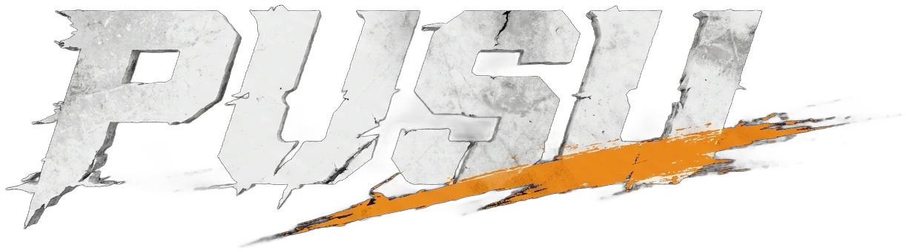</a> İyi avlar.

